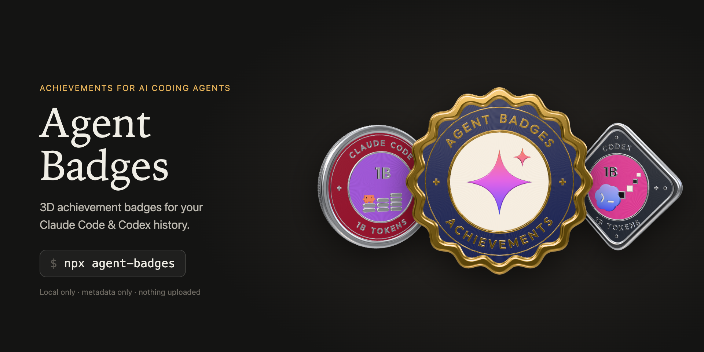
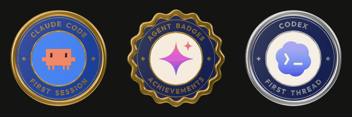
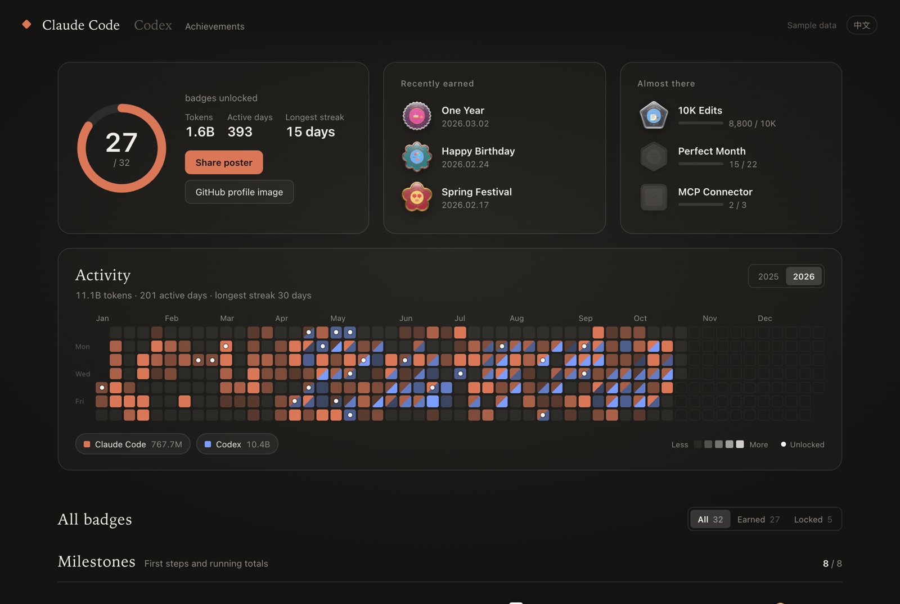
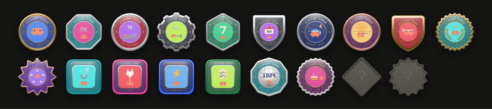
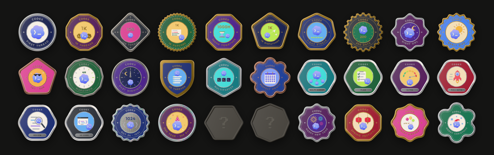
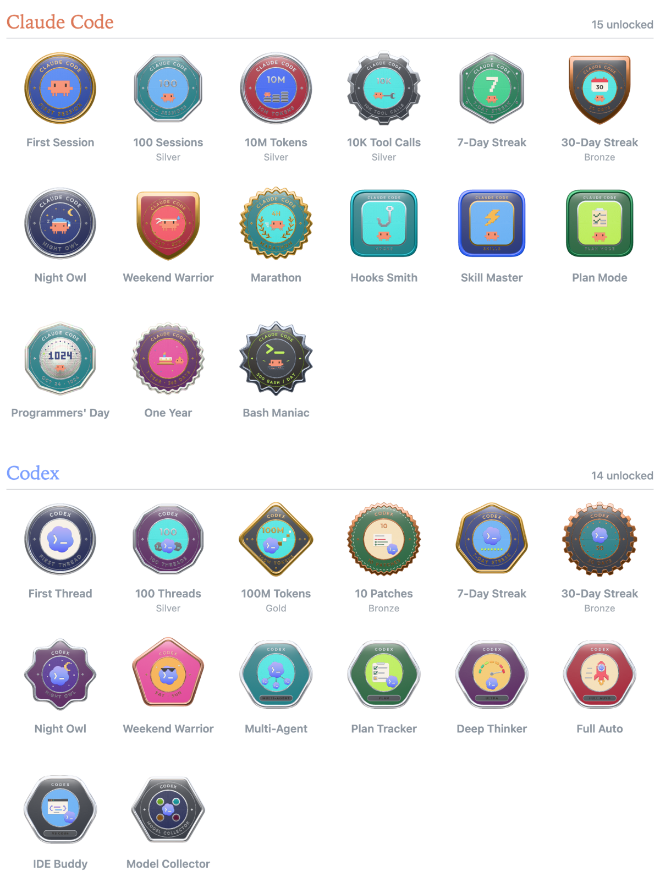
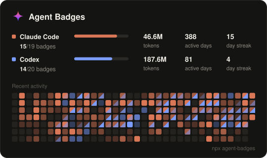

<p align="center">
  
</p>

<p align="center">
  <a href="https://www.npmjs.com/package/agent-badges"></a>
  <a href="https://github.com/Aryous/agent-badges/actions/workflows/ci.yml"></a>
  
  <a href="LICENSE"></a>
  <a href="https://aryous.github.io/agent-badges/demo/?lang=zh"></a>
  <a href="https://github.com/Aryous/agent-badges/stargazers"></a>
</p>

<p align="center">
  <a href="README.md">English</a> · <b>简体中文</b> · <a href="https://aryous.github.io/agent-badges/?lang=zh">官网</a> · <a href="https://aryous.github.io/agent-badges/demo/?lang=zh">在线演示</a>
</p>

把你在 Claude Code 和 Codex 里的使用记录，变成一枚枚可以收藏的 3D 成就徽章，就像 Apple Watch 的健身徽章。

```bash
npx agent-badges
```

一条命令打开你的徽章墙。所有计算都在本机完成：只读记录里的时间和用量数字，不碰对话内容，也不上传任何东西（[详见隐私说明](#隐私)）。

也可以直接问 Agent：在 Claude Code 或 Codex 里[装上技能](#在-claude-code-和-codex-里用)，说一句「看看我的徽章」就行。

<p align="center">
  
</p>

## 有什么

- **两个工具，62 枚徽章。** Claude Code 32 枚，Codex 30 枚，分为里程碑、连续与习惯、功能探索、节日限定几个系列，还藏着几枚彩蛋。分级徽章从铜、银到金逐级升级，Token 徽章再多一级白金；最高一级有三款设计，解锁时随机得到其中一款。
- **真正的 3D。** 每枚徽章都由 three.js 按配置实时生成，材质有珐琅、抛光金属、拉丝金属、陶瓷、全息镭射和水晶。可以拖着转，也可以翻到背面看刻字。
- **成就档案。** 解锁进度、累计 Token、活跃天数、最长连续天数一目了然，还能看到最近拿到了哪几枚、哪几枚快到手了。
- **年度热力图。** 每天的 Token 用量排成一张日历。两个工具同一天都用过，那一格就是两种颜色；解锁徽章的日子会多一个小圆点。
- **方便分享。** 单枚徽章可以导出 2048 像素的 PNG（透明或深色背景），整面墙可以一键生成分享海报，也可以把徽章挂到 GitHub 个人主页上。
- **中英双语。** 页面语言跟随浏览器，顶栏可以随时切换。



<details>
<summary><b>全部徽章</b></summary>

**Claude Code**



**Codex**



显示为 `???` 的是隐藏成就，拿到之后才会揭晓。

</details>

## 快速开始

需要 **Node.js 22.15 或更高版本**（要用到 Node 自带的 zstd 解压和 SQLite）。日常在 macOS 上开发，CI 跑在 Linux 上；Windows 理论上能用，但还没实际测过。

```bash
npx agent-badges                    # 采集本机数据，打开徽章墙
npx agent-badges collect            # 只采集，在终端里打印汇总
npx agent-badges collect --json     # 同上，输出 JSON
npx agent-badges export ./my-wall   # 导出一个能离线打开的网页（包含你的统计数字）
npx agent-badges publish            # 把徽章放到 GitHub 个人主页（动手前会先问你）
npx agent-badges shelf              # 把已解锁的徽章画成一张 PNG
npx agent-badges card               # 生成一张成就卡片 SVG
```

| 选项 | |
| --- | --- |
| `--brand claude-code\|codex` | 只看其中一个工具 |
| `--port <端口>` | 本地页面的端口（默认 4747，被占用时自动往后找） |
| `--no-open` | 不自动打开浏览器 |
| `--json` | `collect` 的汇总改为 JSON 输出 |
| `--lang en\|zh` | 汇总、徽章图和卡片的语言（汇总默认跟随系统，徽章图和卡片默认英文） |
| `--out <文件>` | `shelf` 或 `card` 的保存位置 |
| `--yes` | `publish` 不再询问，直接执行（建议先看过一次计划再用） |
| `--name <名字>` | 卡片和公开徽章墙上显示的名字（默认是你的 GitHub 用户名） |
| `--theme dark\|light` | 卡片配色 |

| 环境变量 | 默认值 |
| --- | --- |
| `AGENT_BADGES_HOME` | `~/.agent-badges`（账本和缓存放在这里） |
| `CLAUDE_CONFIG_DIR` | `~/.claude` |
| `CODEX_HOME` | `~/.codex` |

第一次运行要把全部会话记录读一遍，Codex 记录有好几 GB 的话会花一些时间；之后每次只处理新增或改动过的文件。

## 在 Claude Code 和 Codex 里用

装上技能后，用平常说话的方式问就行，比如「看看我的徽章」「我刚解锁了什么」，或者英文的 "check my badges"。Agent 会在本机跑一遍命令，然后告诉你新解锁了哪些、一共解锁了多少、离哪几枚最近。

```text
> 看看我的徽章

上次之后新解锁：Bash 狂人。
Claude Code：已解锁 27 / 32。
快解锁了：连接者 2 / 3 · 子代理指挥官 3 / 5 · Token 里程碑 4.8B / 10B。

要我打开 3D 徽章墙，或者生成一张 GitHub 个人主页的成就卡片吗？
```

<sub>以上回复用示例数据生成。</sub>

### Claude Code

```text
/plugin install agent-badges --marketplace Aryous/agent-badges
```

如果 Claude Code 版本较旧，要先添加插件市场：`/plugin marketplace add Aryous/agent-badges`，再运行 `/plugin install agent-badges@agent-badges`。

### Codex

```bash
codex plugin marketplace add Aryous/agent-badges
codex plugin add agent-badges@agent-badges
```

只想装技能、不装整个插件，可以在 Codex 里说：

```text
$skill-installer install https://github.com/Aryous/agent-badges/tree/main/skills/badges
```

装好后新开一个 Codex 会话，技能才会生效。

### 其他 Agent

技能本身是一个标准的 [Agent Skills](https://agentskills.io) 目录：[`skills/badges`](skills/badges)，可以复制到任何支持 `SKILL.md` 的 Agent 里。也可以不装技能，让 Agent 直接调用命令、读取 [JSON 输出](#json-输出)。

### 技能会做什么

- **怎么叫它。** 问起你的徽章就行。也可以手动调用：Claude Code 里输入 `/agent-badges:badges`；Codex 里输入 `$` 后选 `agent-badges:badges`（只装了技能的话是 `$badges`）。
- **实际运行的命令。** `npx -y agent-badges@latest collect --json`。每次都用 npm 上的最新版，出了新徽章也不用重装。
- **权限。** 在 Claude Code 里，技能只预先放行只读的命令（`collect`，以及不带 `--yes` 的 `publish`），会改动东西的操作照样先问你。在 Codex 里，命令跑在沙箱中；因为 npx 要联网下载，还要写入 `~/.agent-badges`，Codex 一般会先请你确认。
- **不越界。** Agent 只转述命令的输出，不会编造徽章、日期或数字。打开徽章墙、生成主页图片、导出网页这类操作，它只提议、不擅自执行；提交或推送你的主页仓库之前也会先问你。

### JSON 输出

写脚本，或者 Agent 没装技能的时候，可以直接读 JSON：

```bash
npx agent-badges collect --json --lang zh
```

```json
{
  "home": "/Users/you/.agent-badges",
  "brands": [
    {
      "id": "claude-code",
      "brand": "Claude Code",
      "unlocked": 27,
      "total": 32,
      "newUnlocks": [{ "id": "bash-maniac", "title": "Bash 狂人", "earnedAt": "2025-11-19" }],
      "recent": [{ "id": "anniversary", "title": "一周年", "earnedAt": "2026-03-02" }],
      "nearMiss": [{ "id": "tokens", "title": "Token 里程碑", "current": 48000000, "target": 100000000 }]
    }
  ]
}
```

- `newUnlocks`：上次运行以来新拿到的徽章，第一次运行时为空。分级徽章会带上 `tier`：`bronze`、`silver`、`gold`、`platinum`，到了最高一级则是抽到的那一款（`ivory-gold`、`onyx-gold`、`sapphire`）；升级时 `upgrade` 为 `true`。
- `recent`：最近拿到的三枚。
- `nearMiss`：离解锁最近的几枚，最多三枚。
- 本机没装的工具不会出现在结果里。加 `--brand codex` 只看一个工具，加 `--lang en` 输出英文名称。

## 放到 GitHub 个人主页

跟 Agent 说「把我的徽章放到 GitHub 主页」，或者自己运行：

```bash
npx agent-badges publish --lang zh
```

你的主页上会多出一张徽章图，点开就是你在 GitHub Pages 上的 3D 徽章墙。实际效果可以看 [github.com/Aryous](https://github.com/Aryous) → [aryous.github.io/Aryous](https://aryous.github.io/Aryous/)。

运行后会先做检查、列出计划，等你确认了才开始：

1. 如果还没有主页仓库（`<用户名>/<用户名>`），新建一个公开仓库；
2. 在浏览器标签页里画出你已解锁的徽章；
3. 写入公开徽章墙和徽章图，把图片加到 README 中 `<!-- agent-badges:start -->` 和 `<!-- agent-badges:end -->` 之间。已有的主页 README 只会在末尾追加这一段，其他内容原样保留；
4. 提交、推送、开启 GitHub Pages，等网页能访问为止。

以后想更新，再运行一次就行。仓库副本放在 `~/.agent-badges/profile/`，由工具自己维护，你不用手动克隆。

**前提：** 装好 [GitHub CLI（gh）](https://cli.github.com)，并用 `gh auth login` 登录。推送时只借用 gh 的登录状态，不会改你的 git 配置。

**会公开哪些内容：** 已解锁的徽章和等级、解锁进度和日期，以及每天的 Token 用量和对话轮数（用来画热力图）。页面上看不到的东西不会放进去：没解锁的隐藏徽章不放，更新时间只精确到日期，详细账本（几点在用、调用了哪些工具、用了哪些模型）不会离开你的电脑。注意，旧版本会一直留在仓库的 git 历史里。

遇到这几种情况，它会停下来提醒你，不做任何改动：主页仓库是私有的；GitHub Pages 已经设成从别处发布；仓库根目录里已经有一个不是由它生成的 `index.html`。

想自己管理仓库的话，用 `npx agent-badges profile 路径/<用户名>`：只把徽章图和网页写进这个目录，再打印出要加到 README 里的那一行，不会替你提交。

### 只要徽章图

```bash
npx agent-badges shelf --out 路径/<用户名>/agent-badges-shelf.png --lang zh
```

3D 徽章要靠 WebGL 渲染，所以这条命令会在浏览器里打开一个标签页，画好已解锁的徽章后自动保存成 PNG。一共两张：一张配 GitHub 深色主题，一张配浅色主题（`agent-badges-shelf-light.png`）。两张都是透明背景，只有文字颜色不同。图里只有已解锁的徽章、名称和等级，没有日期和用量数字。在徽章墙上点「GitHub 主页图」按钮也能生成。

在 README 里这样引用，访客会看到和自己主题匹配的那一张：

```html
<picture>
  <source media="(prefers-color-scheme: light)" srcset="./agent-badges-shelf-light.png">
  
</picture>
```

<p align="center">
  
</p>

### 成就卡片

```bash
npx agent-badges card --name "你的名字" --lang zh
```

生成 `agent-badges-card.svg`，上面是解锁数、累计数字、最长连续天数和最近的活动格子。卡片里只有数字；不需要浏览器，在远程服务器上也能生成。

```markdown

```

<p align="center">
  <picture>
    <source media="(prefers-color-scheme: light)" srcset="assets/card-light.svg" />
    
  </picture>
</p>

## 隐私

Agent Badges 读的是 Claude Code 和 Codex 在你电脑上留下的记录，所以规则定得很严，而且每一条都有测试保证。

- **只在本机运行。** 读取 `~/.claude` 和 `~/.codex`，结果写进 `~/.agent-badges`。本地页面只监听 `127.0.0.1`，同一局域网里的其他设备也打不开。不发任何网络请求，也没有任何统计。
- **只读元数据。** 每读一行记录，只留下白名单里的字段：时间戳、Token 数、工具名和几个模式取值。对话内容、代码、工具参数和返回结果当场丢弃，从不保存。可能透露你在做什么的名字（MCP 服务名、Codex 的模型名）会做哈希；Claude 的模型名只保留系列名（opus、sonnet、haiku、fable）。
- **从不打开的文件。** Claude Code：`settings.json`、`.credentials.json`、MCP 配置、`history.jsonl`、`shell-snapshots`、`session-env`、`paste-cache`、`file-history`。Codex：`auth.json`、`config.toml`、`*.env`、`history.jsonl`、`transcription-history.jsonl`、`thread_history*.sqlite`、`logs*.sqlite`、`memories*`、`shell_snapshots`、`chatgpt-meetings`。
- **Codex 会话索引库。** `state_*.sqlite` 以只读方式打开，只查六列：创建时间、来源、会话类型、模型、推理强度和审批策略。标题、首条消息、预览、路径、git 信息和账号 id 一概不读。
- **保存了什么。** `~/.agent-badges` 里只有按天汇总的账本，内容是数字、日期和哈希。就算工具清理了旧记录，已经拿到的徽章也不会消失。
- **有测试兜底。** 测试会在伪造的 `~/.claude` 和 `~/.codex` 里放进假密钥、对话、路径和会话标题，完整跑一遍采集和导出，确认这些内容不会出现在任何输出里。

在线演示和 npm 包里都没有任何个人数据。只有 `export`、`card`、`shelf` 和 `profile` 会生成带你个人数据的文件，而且只写到你指定的位置。`publish` 和 `profile` 生成的网页本来就是要公开的，具体公开哪些内容见[放到 GitHub 个人主页](#放到-github-个人主页)。

## 统计口径

| | Claude Code | Codex |
| --- | --- | --- |
| 会话 / 线程 | Claude Code 记录里的会话（子代理记录不算） | 你自己发起的线程（VS Code、CLI、`exec`），子代理和自动审查不算 |
| Token | 输入 + 输出 + 缓存写入 + 缓存命中（和 ccusage 一致），含子代理记录；同一条消息只算一次，取最完整的数字 | 输入（含缓存命中）+ 输出，同一次响应只算一次；分叉或子代理线程从父线程复制来的记录只算一次 |
| 工具调用 | 只算主会话（子代理的调用不算） | — |
| 夜猫子 / 早起鸟 | 你发消息时的本地时间（0–5 点 / 5–7 点） | 你发起一轮对话时的本地时间 |
| 马拉松 | 单个会话的活跃时长，两条记录间隔超过 30 分钟的部分不算 | 同左 |
| 连续天数 | 有任何活动的连续天数 | 同左 |
| 协作时长 | 所有会话活动时间的并集（几个会话同时开着只算一次），间隔超过 30 分钟的部分不算 | 同左，只算你自己发起的线程 |
| 跨日夜战 | 同一个会话 23 点前在活动，次日 2 点后还在活动，中间每次间隔都不超过 60 分钟 | 同左 |
| 高产日 / 多线并行 | 一天开启 20 个会话 / 同一时刻 3 个会话都在活动（子代理不算） | 同左，只算你自己发起的线程 |
| 全勤月 | 某个自然月的每个工作日（周一到周五）都有活动 | 同左 |
| 子代理派遣 | 主会话派出子代理的次数 | 你自己发起的线程里调用 `spawn_agent` 的次数 |
| 联网检索 / 文件编辑 | `WebSearch` + `WebFetch` / `Edit` + `MultiEdit` + `Write` + `NotebookEdit` 的调用次数，含子代理 | — |
| 节日 | 1 月 1 日、农历正月初一、12 月 25 日、Claude Code 发布日（2 月 24 日）当天有活动 | 同左，生日换成 Codex CLI 发布日（4 月 16 日） |

徽章定义在 [`src/brands`](src/brands)，各工具的统计规则在 `src/data/<工具>-metrics.js`。

## 参与贡献

欢迎提 Issue 和 PR。开发环境、目录结构，以及新增徽章、新增工具的步骤，见 [CONTRIBUTING.md](CONTRIBUTING.md)（英文）。

## 致谢

- 文字环的字形取自 [Outfit](https://fonts.google.com/specimen/Outfit) Bold（SIL Open Font License 1.1），用 `node scripts/build-font.mjs` 提取。
- Codex 标志的路径来自 [LobeHub Icons](https://github.com/lobehub/lobe-icons)（MIT）。
- Claude Code 像素小怪物照着 [Simple Icons](https://simpleicons.org/) 里的 Claude Code 图标逐格还原。
- 渲染用的是 [three.js](https://threejs.org/)。

## 免责声明

Agent Badges 是一个非官方、非商业的兴趣项目，与 Anthropic、OpenAI 没有关联，也没有得到它们的认可或赞助。Claude、Claude Code、Codex 及相关标志是各自所有者的商标，这里只用来标明每枚徽章对应的是哪个工具。MIT 许可只覆盖本项目的代码，不授予这些商标的任何权利。

## 许可

[MIT](LICENSE) © 2026 Aryous
