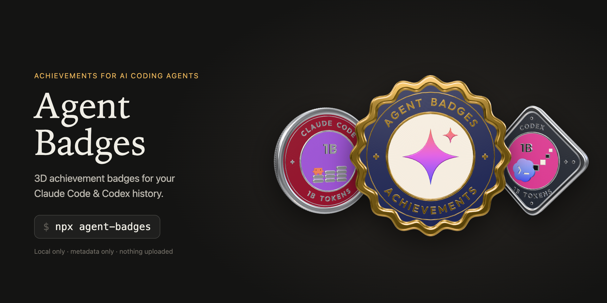
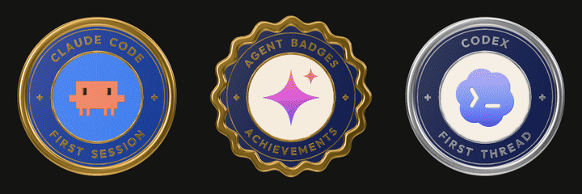
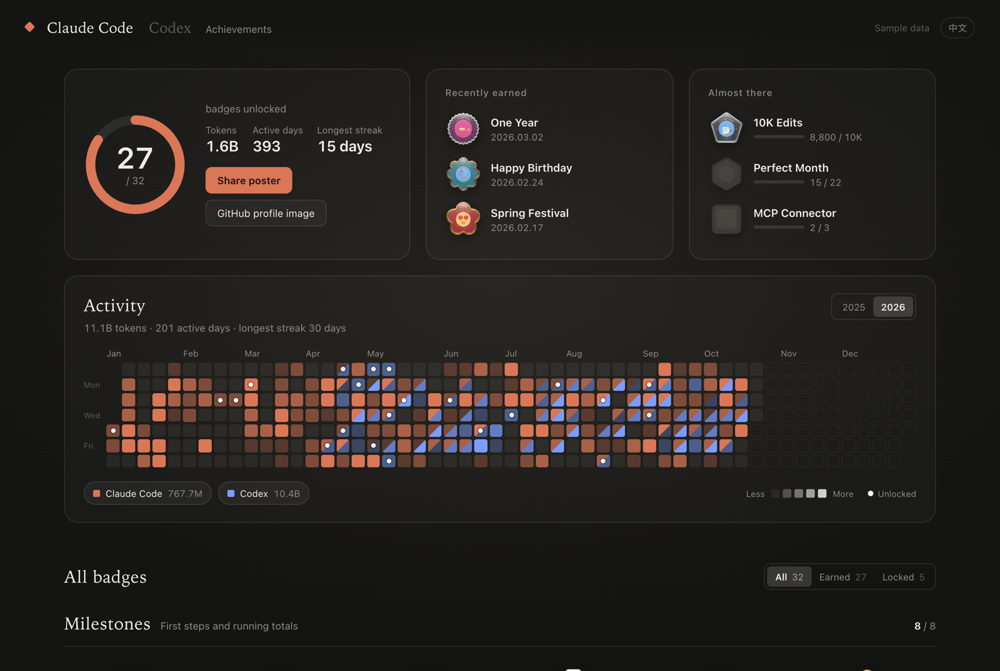
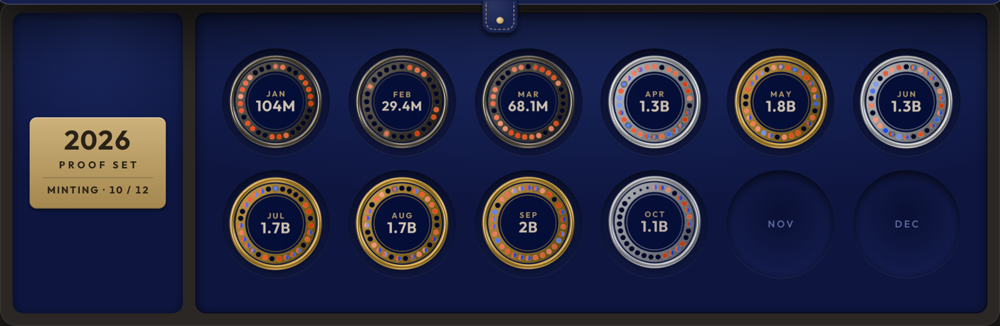
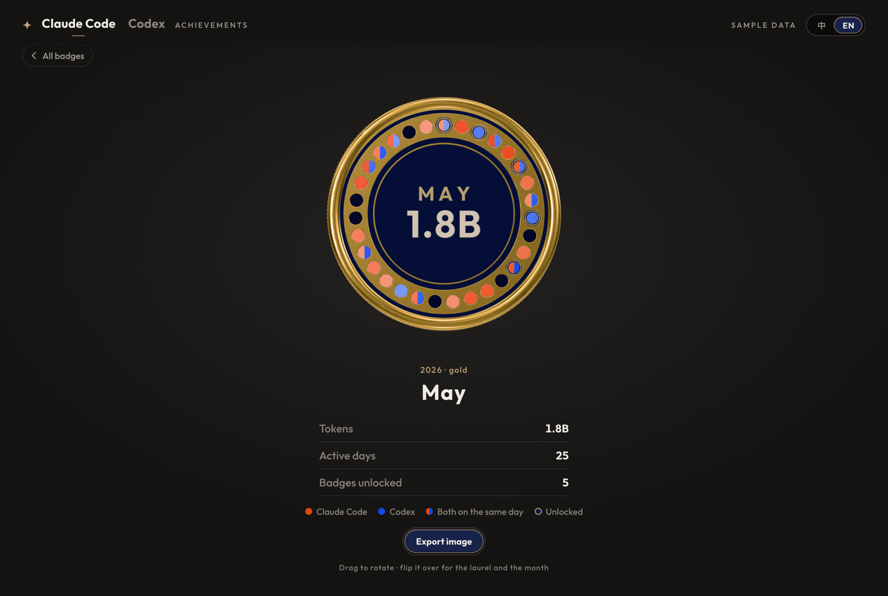
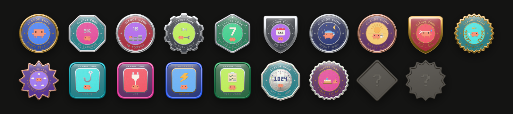
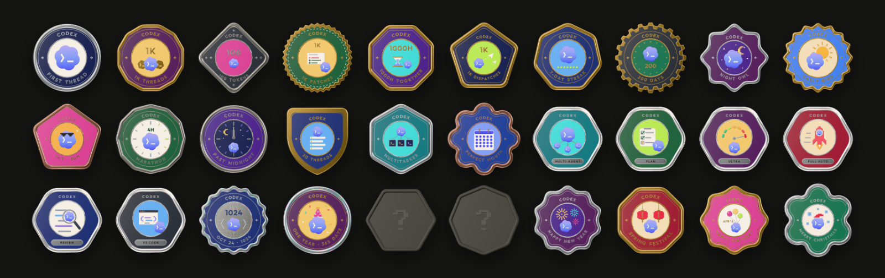
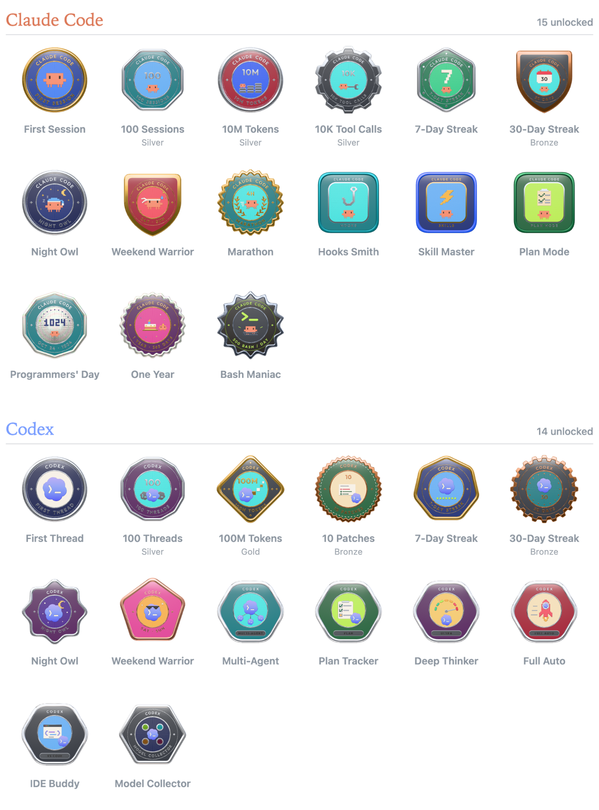
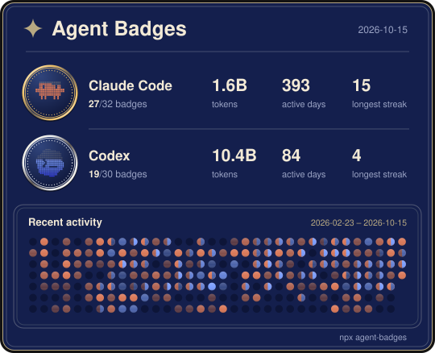

<p align="center">
  
</p>

<p align="center">
  <a href="https://www.npmjs.com/package/agent-badges"></a>
  <a href="https://github.com/Aryous/agent-badges/actions/workflows/ci.yml"></a>
  
  <a href="LICENSE"></a>
  <a href="https://aryous.github.io/agent-badges/demo/?lang=zh"></a>
  <a href="https://github.com/Aryous/agent-badges/stargazers"></a>
</p>

<p align="center">
  <a href="README.md">English</a> · <b>简体中文</b> · <a href="https://aryous.github.io/agent-badges/?lang=zh">官网</a> · <a href="https://aryous.github.io/agent-badges/demo/?lang=zh">在线演示</a>
</p>

Agent Badges 根据 Claude Code 和 Codex 的本地使用记录生成可收藏的 3D 成就徽章。灵感来自 Apple Watch 的健身徽章。连续活跃、达到 Token 用量里程碑或使用特定工具，都可以解锁相应的徽章。

```bash
npx agent-badges
```

运行上面的命令即可在浏览器中打开个人徽章墙。徽章进度在本机计算，采集器仅保留统计所需的元数据，对话正文和代码不会写入统计结果。[了解数据处理方式](#隐私)

**让 Agent 帮你安装。** 把下面这段话复制给 Claude Code、Codex 或其他支持 Agent Skills 的编程助手。

```text
请按 https://github.com/Aryous/agent-badges 的中文 README，选择适合当前环境的方式安装 skills/badges 技能。
安装后请用这个技能查询我的本地徽章，告诉我已经解锁了多少枚，以及哪一枚最接近解锁。
如果需要新开会话才能加载技能，请告诉我在新会话中输入什么。
```

安装后，可以用自然语言调用 `badges` 技能。例如，问「我最近解锁了什么？下一枚徽章还差多少？」可查看收藏进度。说「打开我的 3D 徽章墙」可浏览收藏，说「导出离线徽章墙」可保存本地副本。要在 GitHub 个人主页展示收藏，可以说「把我的徽章放到 GitHub 主页」，Agent 会列出发布计划和公开的数据，等你确认后再发布。[查看各平台的安装命令](#在-claude-code-和-codex-里用)

<p align="center">
  
</p>

## 主要功能

- **62 枚徽章。** Claude Code 32 枚，Codex 30 枚，涵盖里程碑、连续使用与习惯、功能探索和节日限定四个系列，其中部分为隐藏成就。分级徽章随进度从铜级升至银级、金级。Token 里程碑另设白金级，最高等级解锁时会获得三款设计中的一款。
- **3D 徽章展示。** three.js 实时渲染徽章的珐琅、抛光金属、拉丝金属、陶瓷、全息和水晶等材质。拖动徽章可旋转视角，也可翻至背面查看刻字。
- **成就档案。** 全解锁铸币用马赛克记录收藏进度。每解锁一枚徽章，正面图案就更完整。解锁比例达到 25%、50% 和 75% 时，锡质外圈依次升级为铜、银和金。档案同时展示累计 Token 用量、活跃天数、最长连续活跃天数，以及最近解锁和即将解锁的徽章。
- **年度热力图。** 午夜蓝珐琅底板上的每个凹点代表一天，颜色亮度表示当天的使用量。同一天使用两种工具时，凹点按左右两半分别着色。金色描边标记解锁徽章的日期。通过图例可筛选工具，通过年份选择器可查看往年记录。
- **年度铸币套装。** 拉开热力图下方的抽屉，即可查看按月陈列的 3D 月章。每颗珐琅珠代表一天，外圈金属表示该月的 Token 用量。以当年用量最高的月份为基准，低于 25% 时外圈为锡，达到 25%、50%、75% 时依次升级为铜、银、金。选中月章可将其移出托盘，旋转查看背面的月桂纹样和月份。
- **导出与分享。** 单枚徽章和月章可导出为 2048 像素的 PNG，支持透明或深色背景。分享海报可展示单个工具的收藏，也可并列展示两个工具的收藏。完整的徽章墙可发布到 GitHub 个人主页。
- **中英双语。** 界面默认跟随浏览器语言，也可通过顶栏切换。



<p align="center">
  
  
</p>

<details>
<summary><b>全部徽章</b></summary>

**Claude Code**



**Codex**



`???` 表示尚未解锁的隐藏成就，名称会在解锁后显示。

</details>

## 快速开始

需要 **Node.js 22.15 或更高版本**，以使用内置的 zstd 解压和 SQLite 支持。项目在 macOS 上开发，持续集成测试在 Linux 上运行。Windows 兼容性尚未验证。

```bash
npx agent-badges                    # 采集本机使用记录并打开徽章墙
npx agent-badges collect            # 在终端显示采集结果
npx agent-badges collect --json     # 以 JSON 格式输出采集结果
npx agent-badges export ./my-wall   # 导出可离线查看的徽章墙，包含个人统计及已启用的头像
npx agent-badges publish            # 查看发布计划，确认后更新 GitHub 个人主页
npx agent-badges shelf              # 生成已解锁徽章的 PNG 陈列图
npx agent-badges card               # 生成 SVG 成就卡片
npx agent-badges avatar             # 确认后获取 GitHub 头像，用于分享海报
```

| 选项 | 用途 |
| --- | --- |
| `--brand claude-code\|codex` | 选择要查看的工具 |
| `--port <端口>` | 指定本地页面端口，默认 `4747`。端口被占用时自动尝试后续端口 |
| `--no-open` | 启动本地页面时不自动打开浏览器 |
| `--json` | 以 JSON 格式输出 `collect` 汇总结果 |
| `--lang en\|zh` | 设置输出语言。终端汇总默认跟随系统语言，徽章图和成就卡片默认使用英文 |
| `--out <文件>` | 指定 `shelf` 或 `card` 的输出路径 |
| `--yes` | 跳过 `publish` 的发布确认或 `avatar` 的头像获取确认 |
| `--remove` | 与 `avatar` 配合使用，删除已保存的头像 |
| `--name <名字>` | 设置成就卡片或公开徽章墙的显示名称 |
| `--theme dark\|light` | 设置成就卡片的深色或浅色主题 |

| 环境变量 | 默认值 |
| --- | --- |
| `AGENT_BADGES_HOME` | `~/.agent-badges`（本地账本和缓存目录） |
| `CLAUDE_CONFIG_DIR` | `~/.claude` |
| `CODEX_HOME` | `~/.codex` |

首次运行会扫描已有的会话记录，耗时取决于记录总量。后续运行仅处理新增或修改过的文件。

## 在 Claude Code 和 Codex 里用

安装技能后，可以直接问「看看我的徽章」或「我刚解锁了什么？」。Agent 会在本机查询徽章进度，列出新增成就、已解锁数量，以及最接近解锁条件的徽章。也支持英文提问，例如 “check my badges”。

```text
> 看看我的徽章

自上次查询以来，新解锁了「Bash 狂人」。
Claude Code 已解锁 27 / 32 枚徽章。
即将解锁：连接者 2 / 3 · 子代理指挥官 3 / 5 · Token 里程碑 4.8B / 10B。

要打开 3D 徽章墙，还是生成用于 GitHub 个人主页的成就卡片？
```

<sub>示例回复，使用演示数据。</sub>

### Claude Code

```text
/plugin install agent-badges --marketplace Aryous/agent-badges
```

较旧版本的 Claude Code 需要先运行 `/plugin marketplace add Aryous/agent-badges` 添加插件市场，再运行 `/plugin install agent-badges@agent-badges` 安装插件。

### Codex

```bash
codex plugin marketplace add Aryous/agent-badges
codex plugin add agent-badges@agent-badges
```

如需单独安装徽章技能，可在 Codex 中输入以下指令。

```text
$skill-installer install https://github.com/Aryous/agent-badges/tree/main/skills/badges
```

安装完成后，新建 Codex 会话即可使用技能。

### 其他 Agent

[`skills/badges`](skills/badges) 采用 [Agent Skills](https://agentskills.io) 目录格式，可复制到其他支持 `SKILL.md` 的 Agent 中。通过命令行集成时，Agent 也可以直接读取 [JSON 输出](#json-输出)。

### 技能调用与权限

- **调用方式。** 可以用自然语言查询，也可以在 Claude Code 中输入 `/agent-badges:badges`。在 Codex 中输入 `$` 后选择 `agent-badges:badges`。单独安装技能时，名称为 `$badges`。
- **版本。** 查询时运行 `npx -y agent-badges@latest collect --json`，使用 npm 上发布的最新版本。新增徽章随 CLI 更新，无需重新安装技能。
- **执行权限。** Claude Code 技能预先允许 `collect` 和不带 `--yes` 的 `publish` 命令。实际发布前仍需确认。Codex 在沙箱中运行命令，下载 npm 包或写入 `~/.agent-badges` 时可能需要授权。
- **查询与操作。** Agent 根据命令输出报告徽章名称、解锁日期和进度。打开徽章墙、生成图片或导出网页时，由用户选择是否执行。向 GitHub 主页仓库提交和推送前需要确认。

### JSON 输出

脚本和 Agent 可以通过以下命令获取结构化结果。

```bash
npx agent-badges collect --json --lang zh
```

```json
{
  "home": "/Users/you/.agent-badges",
  "brands": [
    {
      "id": "claude-code",
      "brand": "Claude Code",
      "unlocked": 27,
      "total": 32,
      "newUnlocks": [{ "id": "bash-maniac", "title": "Bash 狂人", "earnedAt": "2025-11-19" }],
      "recent": [{ "id": "anniversary", "title": "一周年", "earnedAt": "2026-03-02" }],
      "nearMiss": [{ "id": "tokens", "title": "Token 里程碑", "current": 48000000, "target": 100000000 }]
    }
  ],
  "failed": []
}
```

- `newUnlocks` 列出自上次运行以来新解锁或升级的徽章，首次运行时为空。分级徽章的 `tier` 可以是 `bronze`、`silver`、`gold` 或 `platinum`。达到最高等级时，该字段记录具体款式（`ivory-gold`、`onyx-gold` 或 `sapphire`）。升级记录带有 `upgrade: true`。
- `recent` 列出最近解锁的徽章，最多三枚。
- `nearMiss` 列出最接近解锁条件的徽章，最多三枚，并给出当前进度和目标值。
- `failed` 列出本次采集失败的工具 ID。失败原因输出到标准错误流（stderr）。全部成功时，该列表为空。
- 结果仅包含本机已安装的工具。使用 `--brand codex` 可限定工具范围，使用 `--lang en` 可输出英文徽章名称。

## 放到 GitHub 个人主页

要在 GitHub 个人主页展示徽章，可以请 Agent「把我的徽章放到 GitHub 主页」，也可以直接运行发布命令。

```bash
npx agent-badges publish --lang zh
```

发布后，个人主页 README 会显示一张徽章陈列图。点击图片即可打开托管在 GitHub Pages 上的 3D 徽章墙。[个人主页示例](https://github.com/Aryous) · [公开徽章墙示例](https://aryous.github.io/Aryous/)

发布前需要安装 [GitHub CLI（gh）](https://cli.github.com)，并运行 `gh auth login` 登录。工具使用当前登录凭据推送，无需修改 Git 配置。`publish` 会先检查仓库并显示发布计划，默认在确认后执行以下操作。

1. 检查个人主页仓库（`<用户名>/<用户名>`），如尚未创建，则新建公开仓库。
2. 在浏览器中渲染已解锁的徽章，生成陈列图。
3. 写入公开徽章墙和陈列图，并更新主页 README 中 `<!-- agent-badges:start -->` 与 `<!-- agent-badges:end -->` 之间的内容。首次添加时，将该区段追加到 README 末尾。
4. 提交并推送变更，按需启用 GitHub Pages，然后检查页面是否可访问。

再次运行 `publish` 即可更新主页。工具在 `~/.agent-badges/profile/` 维护仓库副本。

**公开数据。** 徽章墙包含已解锁的徽章、等级、进度和解锁日期，以及绘制热力图所需的每日 Token 用量和对话轮数。更新时间仅精确到日期。详细账本保存在本机，具体使用时段、工具调用记录和模型名称均不随页面发布。

如果已通过 `npx agent-badges avatar` 启用头像，且头像属于当前发布所用的 GitHub 账号，公开页面还会包含分享海报所需的用户名和头像。历史版本会保留在主页仓库的 Git 历史中。

**发布条件。** 主页仓库为私有仓库、GitHub Pages 已配置其他发布来源，或仓库根目录已有用户或其他工具维护的 `index.html` 时，`publish` 会停止并说明原因。如果任一工具采集失败，`publish`、`card`、`shelf` 和 `profile` 都会停止，以免用不完整的结果覆盖已有文件。

如需自行管理主页仓库，可在该仓库的根目录运行 `npx agent-badges profile .`。命令会在当前目录生成徽章图和网页，并输出可加入 README 的引用代码。提交和推送由你自行完成。

### 导出徽章陈列图

```bash
npx agent-badges shelf --out ./agent-badges-shelf.png --lang zh
```

`shelf` 会打开浏览器标签页，使用 WebGL 渲染已解锁的徽章，并保存适配 GitHub 深色和浅色主题的两张透明 PNG。浅色主题文件名为 `agent-badges-shelf-light.png`。两张图仅文字颜色不同，展示徽章名称和等级，不包含解锁日期或用量。徽章墙上的「GitHub 主页图」按钮也可生成这些图片。

将以下代码加入主页 README，GitHub 会根据访客的主题显示相应图片。

```html
<picture>
  <source media="(prefers-color-scheme: light)" srcset="./agent-badges-shelf-light.png">
  
</picture>
```

<p align="center">
  
</p>

### 成就卡片

```bash
npx agent-badges card --name "你的名字" --lang zh
```

`card` 在本地生成 `agent-badges-card.svg`，其中包含徽章解锁数、累计 Token 用量、活跃天数、最长连续活跃天数和近期活动分布。该命令无需浏览器，也可在远程服务器上运行。

```markdown

```

<p align="center">
  <picture>
    <source media="(prefers-color-scheme: light)" srcset="assets/card-light.svg" />
    
  </picture>
</p>

## 隐私

Agent Badges 在本机解析会话记录并计算徽章进度。采集器按字段筛选元数据，对话正文、代码、工具参数和返回结果不会写入账本或缓存。

- **本地运行与联网。** 默认从 `~/.claude` 和 `~/.codex` 读取记录，将结果写入 `~/.agent-badges`。徽章墙仅监听 `127.0.0.1`，不含访问统计。默认采集和展示无需上传数据。`publish` 会连接 GitHub，`avatar` 会在获得授权后联网获取头像。
- **保留的字段。** 采集器从日志中提取时间戳、Token 数、工具名称和模式等统计字段。MCP 服务名和 Codex 模型名以哈希值保存。Claude 模型名只保留系列名，如 opus、sonnet、haiku、fable。
- **排除的文件。** Claude Code 采集器不打开 `settings.json`、`.credentials.json`、MCP 配置、`history.jsonl`、`shell-snapshots`、`session-env`、`paste-cache` 和 `file-history`。Codex 采集器不打开 `auth.json`、`config.toml`、`*.env`、`history.jsonl`、`transcription-history.jsonl`、`thread_history*.sqlite`、`logs*.sqlite`、`memories*`、`shell_snapshots` 和 `chatgpt-meetings`。
- **Codex 会话索引。** 采集器以只读方式打开 `state_*.sqlite`，仅查询创建时间、来源、会话类型、模型、推理强度和审批策略六列。标题、首条消息、预览、路径、Git 信息和账号 ID 均不在查询范围内。
- **账本与恢复。** 本地账本保存汇总统计、日期和哈希值。即使原工具清理了旧会话，账本仍保留已获得的徽章。每次更新先写临时文件，再替换账本，并将上一版保留为 `<工具>.ledger.json.bak`。检测到账本损坏时，命令会保留原文件，并给出备份恢复方法。
- **隐私测试。** 测试在模拟的 Claude Code 和 Codex 目录中写入测试密钥、对话文本、路径和会话标题，再执行采集和导出，检查这些内容是否出现在输出中。

在线演示使用示例数据，npm 包不包含个人使用记录。`export`、`card`、`shelf` 和 `profile` 会生成包含个人统计的本地文件。`profile` 与 `publish` 生成的网页采用相同的公开数据范围。[查看公开数据说明](#放到-github-个人主页)

## 统计口径

| 指标 | Claude Code | Codex |
| --- | --- | --- |
| 会话 / 线程 | 按主会话计数，排除子代理会话 | 按用户通过 VS Code、CLI 或 `exec` 发起的线程计数，排除子代理和自动审查线程 |
| Token | 输入、输出、缓存写入和缓存命中之和，口径与 ccusage 一致。包含子代理用量，同一条消息取最完整的记录，仅计一次 | 输入（含缓存命中）与输出之和。同一次响应仅计一次，分叉或子代理线程从父线程复制的记录也仅计一次 |
| 工具调用 | 统计主会话中的工具调用次数 | — |
| 夜猫子 / 早起鸟 | 按用户发送消息的本地时间判定，区间分别为 0 点至 5 点、5 点至 7 点 | 使用相同的时间区间，以用户发起一轮对话的时间为准 |
| 马拉松 | 累计单个会话的活跃时长。相邻记录间隔超过 30 分钟时，该段间隔不计入 | 同左 |
| 连续天数 | 连续有活动记录的天数 | 同左 |
| 协作时长 | 合并所有会话的活跃时段，重叠时间仅计一次。相邻记录间隔超过 30 分钟时，该段间隔不计入 | 同左，仅统计用户发起的线程 |
| 跨日夜战 | 同一会话在 23 点前和次日 2 点后均有活动，期间相邻记录的间隔均不超过 60 分钟 | 同左 |
| 高产日 / 多线并行 | 一天开启 20 个会话 / 同一时刻 3 个会话处于活跃状态，均排除子代理会话 | 同左，仅统计用户发起的线程 |
| 全勤月 | 自然月内每个工作日（周一至周五）均有活动记录 | 同左 |
| 子代理派遣 | 主会话派遣子代理的次数 | 用户发起的线程中调用 `spawn_agent` 的次数 |
| 联网检索 / 文件编辑 | 联网检索统计 `WebSearch` 和 `WebFetch`。文件编辑统计 `Edit`、`MultiEdit`、`Write` 和 `NotebookEdit`。两项均包含子代理调用 | — |
| 节日 | 在 1 月 1 日、农历正月初一、12 月 25 日或 Claude Code 发布日（2 月 24 日）有活动记录 | 节日口径同左，工具发布日为 Codex CLI 发布日（4 月 16 日） |

各工具的徽章定义见 [`src/brands`](src/brands)，统计规则见 `src/data/<工具>-metrics.js`。

## 参与贡献

欢迎通过 Issue 反馈问题，或提交 Pull Request 参与开发。开发环境、目录结构以及新增徽章和工具的步骤见英文[贡献指南](CONTRIBUTING.md)。

在本仓库中新增或重新设计徽章时，可以让编程助手使用贡献者技能 [`add-badge`](.agents/skills/add-badge/SKILL.md)。例如，「为 Codex 新增一枚节日徽章」。技能涵盖徽章设计、解锁规则、示例数据和测试。

## 致谢

- 徽章文字环采用 [Outfit Bold](https://fonts.google.com/specimen/Outfit) 字形，由 `node scripts/build-font.mjs` 提取，遵循 SIL Open Font License 1.1。
- Codex 标志的路径来自 [LobeHub Icons](https://github.com/lobehub/lobe-icons)（MIT）。
- Claude Code 像素角色依据 [Simple Icons](https://simpleicons.org/) 的 Claude Code 图标逐格绘制。
- 3D 场景由 [three.js](https://threejs.org/) 渲染。

## 免责声明

Agent Badges 是独立开发的非官方、非商业项目，与 Anthropic 或 OpenAI 无隶属关系，也未获两家公司的认可或赞助。Claude、Claude Code、Codex 及相关标志的商标权归各自权利人所有，在本项目中仅用于标识徽章对应的工具。MIT 许可适用于项目代码，不包含商标授权。

## 许可

[MIT](LICENSE) © 2026 Aryous
